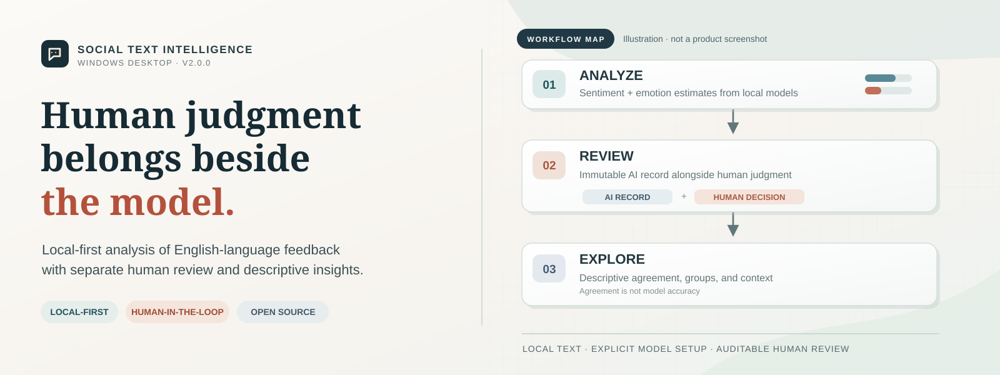
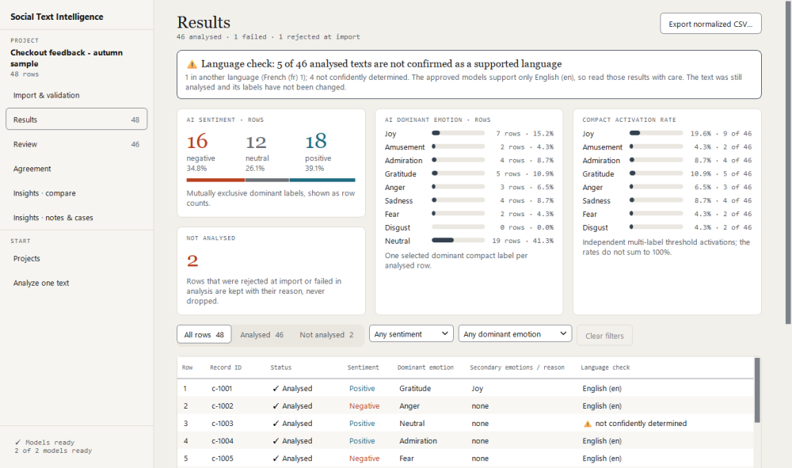
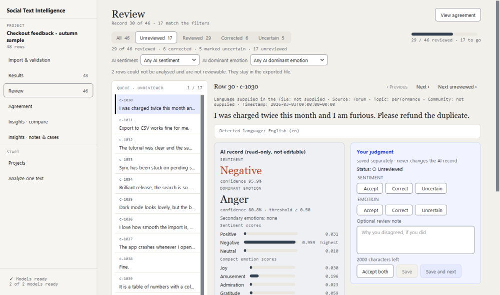
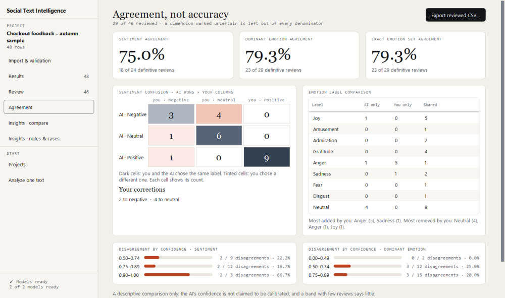
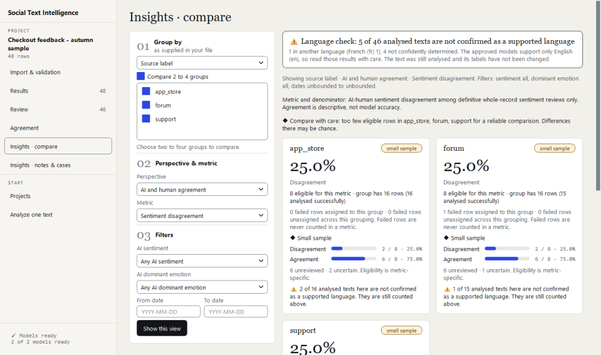

# Social Text Intelligence

**A local-first Windows desktop workbench for exploring English-language feedback through sentiment and emotion estimates, human review, and descriptive insights.**

**Version 2.0.0** · **Windows x64** · **Open-source Python / PySide6 project** · **Conditional portfolio release**

[**Download the Windows installer**](https://github.com/Peter-S-Shi/social-text-intelligence/releases/download/v2.0.0/STI-2.0.0-x64-setup.exe) · [Release notes and SHA-256](https://github.com/Peter-S-Shi/social-text-intelligence/releases/tag/v2.0.0) · [Engineering case study](docs/PORTFOLIO_CASE_STUDY.md) · [Explore the architecture](docs/ARCHITECTURE.md) · [Build from source](#develop-from-source)

> **For reviewers:** The Windows installer is publicly available alongside the source code. It is **unsigned**, and Windows may display a publisher or SmartScreen warning. The installer does **not** include model weights: users explicitly download verified models or import a pre-provisioned model folder before running inference. This is a portfolio release with [documented limitations](#scope-and-limitations), not a certification of model accuracy or full production readiness.



*Conceptual workflow illustration, not a screenshot. Actual native Windows UI captures using synthetic test data appear below.*

## What the desktop app does

Social Text Intelligence (STI) helps you inspect text-derived signals without giving an NLP model the final word. You can import English feedback as local projects, analyze sentiment and fine-grained emotion, review or correct individual predictions, and compare descriptive patterns across user-supplied groups. **The AI record is preserved separately from your judgment.**



*STI V2 native Windows Qt interface. Screenshot captured from the real UI with synthetic example records and synthetic test providers; numerical values are demonstration fixtures, **not measured model accuracy**.*

| Workflow | What is available in the Windows app |
| --- | --- |
| **Local text analysis** | Analyze one text or a CSV-backed project with separate sentiment and emotion outputs, score details, and model provenance. |
| **Projects and import** | Validate CSV rows and the text column; retain records, including rejected or failed items with their reasons; reopen local projects. |
| **Human-in-the-loop review** | Accept, correct, or mark sentiment and emotion judgments uncertain while keeping the original AI result immutable. |
| **Agreement and insights** | Inspect AI–human agreement with explicit denominators, compare trusted metadata groups, and record separate human-written context notes. |
| **Operational safeguards** | Require models to be ready; expose progress and cancellation; do not commit a partially cancelled batch; use explicit exports. |

## A quick look at the workflow

The images below are **native desktop UI captures**, not mockups or benchmark results. Their records and model outputs are synthetic, so the visible percentages must not be read as measurements of real-world NLP performance.

| Human review | Agreement, not accuracy |
| --- | --- |
| <a href="manual-qa/m8-visual-evidence/after/demo_review.png"></a> | <a href="manual-qa/m8-visual-evidence/after/demo_agreement.png"></a> |
| Review decisions are stored independently of the AI record; uncertainty is explicit. | Agreement is descriptive and based on eligible reviewed records, **not ground-truth model accuracy**. |

| Contextual insights | More native screens |
| --- | --- |
| <a href="manual-qa/m8-visual-evidence/after/demo_compare.png"></a> | [Projects](manual-qa/m8-visual-evidence/after/demo_projects.png) · [CSV import and validation](manual-qa/m8-visual-evidence/after/demo_import.png) · [Context notes and cases](manual-qa/m8-visual-evidence/after/demo_notes.png) · [Single-text analysis](manual-qa/m8-visual-evidence/after/demo_direct.png) |
| Compare metadata-defined groups with sample-size warnings and explicit metrics. | Browse other screenshots already committed to the repository; no application installation is needed to view them. |

For the capture method and UI provenance, see the [M8 visual-evidence index](manual-qa/m8-visual-evidence/README.md) and [M8 fidelity record](docs/V2_M8_TRACK_B_FIDELITY.md). The pictures document native interface behavior with test stand-ins; they are not evidence of real-model accuracy or formal accessibility acceptance.

## Download and run on Windows

**[Download STI 2.0.0 for Windows x64](https://github.com/Peter-S-Shi/social-text-intelligence/releases/download/v2.0.0/STI-2.0.0-x64-setup.exe)** — `STI-2.0.0-x64-setup.exe` (726,691,694 bytes).

1. Review the [official GitHub Release](https://github.com/Peter-S-Shi/social-text-intelligence/releases/tag/v2.0.0), its file checksum, and the [third-party notices](THIRD_PARTY_NOTICES.md) before installing. The app installer is **not Authenticode-signed**. Do not disable Windows security controls merely to launch it.
2. Use a **Windows x64** computer with a suitable **Microsoft Visual C++ x64 runtime (14.44 or later)**. The per-user installer checks this prerequisite; the installer does not bundle that runtime.
3. Launch STI and follow its model setup. The two required NLP model weights are **not packaged** in the EXE. Choose the explicit verified download from the model's original host, or import an existing compatible offline model folder. Inference is unavailable until the required models are ready.
4. Analyze one English text or import a CSV project. Results, review decisions, and notes are managed on your computer; exports are deliberate user actions.

**Verify the downloaded installer in PowerShell:**

```powershell
Get-FileHash .\STI-2.0.0-x64-setup.exe -Algorithm SHA256
```

Expected SHA-256:

```text
da7d5d6f8b098250dca2ab35fd9c79bc5a8688a085648e28836b1dd12b914dca
```

The installer is built from the [`v2.0.0` source tag](https://github.com/Peter-S-Shi/social-text-intelligence/tree/v2.0.0). Qt/PySide6 source-access archives and build records are published separately in the [immutable `sources-qt-6.11.2` source release](https://github.com/Peter-S-Shi/social-text-intelligence/releases/tag/sources-qt-6.11.2) and linked directly on the installer release page.

## Engineering highlights

This repository is a software-engineering portfolio as well as a usable desktop application. Its more interesting problems are not just text classification:

- **Separation of concerns.** A framework-neutral application layer and typed contracts sit between the PySide6/Qt Widgets interface, model adapters, and SQLite-backed local persistence. [Architecture](docs/ARCHITECTURE.md) · [Contracts](docs/CONTRACTS.md)
- **Controlled model provisioning.** Two pinned models are acquired only with an explicit user action, checked before use, and recoverable via verified import or download. The installer deliberately excludes model weights. [Provisioning contract](docs/MODEL_PROVISIONING.md) · [Model governance](docs/MODEL_GOVERNANCE.md)
- **Auditable human review.** The app stores human decisions separately from immutable machine predictions, supports uncertainty and corrections, and reports *agreement* using the correct reviewed-record denominators. [Native acceptance inventory](docs/V2_M6_ACCEPTANCE.md)
- **Data integrity and safe failure.** Batch cancellation does not leave partially committed analysis; malformed input, model-readiness failures, and export errors have explicit handling. [Architecture](docs/ARCHITECTURE.md) · [Manual QA materials](manual-qa/README.md)
- **Reproducible release engineering.** The versioned Windows installer is tied to a specific source revision and SHA-256; draft and public Release gates distinguish prepublication checks from publicly verifiable source-access conditions. [Release gate design](docs/V2_R4B_RELEASE_GATE.md) · [Release](https://github.com/Peter-S-Shi/social-text-intelligence/releases/tag/v2.0.0)

### Architecture at a glance

```text
Windows desktop (PySide6 / Qt Widgets)
                 |
        UI controllers / view models
                 |
     Application use cases + contracts
                 |
    +------------+-------------+
    |            |             |
Local SQLite  Model providers   Model provisioning
projects      (sentiment /      and verified imports
              emotion)         / explicit downloads
```

CLI and legacy local Flask interfaces remain in the repository and reuse the application/model infrastructure; the **V2 released product surface is the Windows desktop**. This simplified view is an introduction, not a replacement for the [full architecture documentation](docs/ARCHITECTURE.md).

## Develop from source

For developers who want to inspect or run the current Windows desktop code, rather than use the prebuilt installer:

```powershell
git clone https://github.com/Peter-S-Shi/social-text-intelligence.git
cd social-text-intelligence
python -m venv .venv
.\.venv\Scripts\python.exe -m pip install --upgrade pip
.\.venv\Scripts\python.exe -m pip install -e ".[desktop,sentiment,emotion]"
.\.venv\Scripts\sti-desktop.exe
```

Python **3.11–3.13** is the project's tested CI range; model dependencies and supported versions are defined in [`pyproject.toml`](pyproject.toml). As in the packaged application, model weights are obtained separately through the app's explicit setup process. See [development instructions](docs/DEVELOPMENT.md) and [model provisioning](docs/MODEL_PROVISIONING.md) for the fuller engineering workflow.

The repository also retains command-line (`sti`) and localhost Web (`sti-web`) entry points from V1. They are useful for source-level exploration, but the old Web interface is **not** the Windows V2 screenshot gallery. V1's synthetic Moderation Training and Support Triage workflows were **retired from the V2 desktop surface**; their historical documentation remains in [Moderation Training](docs/MODERATION_TRAINING.md) and [Support Triage](docs/SUPPORT_TRIAGE.md).

For repository contributors, the existing automated checks are documented under [Development](docs/DEVELOPMENT.md); the project has CI jobs for Python 3.11, 3.12 and 3.13 plus the UAT companion. The image gallery itself does not validate executable behavior or model quality.

## Scope and limitations

- **English-focused model inference.** The approved sentiment and emotion models are English-language models. Language detection/warnings do not imply multilingual sentiment or emotion quality.
- **Estimates are not ground truth.** Sentiment/emotion scores and AI–human agreement are descriptive signals, not proof of intent, psychological state, calibrated probabilities, or real-world classification accuracy. Representative-domain model evaluation under M9.2 is not completed.
- **Local-first, not zero-network setup.** Input text is processed locally and is not submitted to a remote inference API. Explicit model acquisition connects to the model host. Projects and exports remain the user's local responsibility. [Privacy](docs/PRIVACY.md)
- **Conditional portfolio release.** The owner reported a passing packaged-app smoke test and accepted the unsigned-installation risk and two remaining icon-observation evidence gaps. Full formal Windows UAT, accessibility acceptance, and the M9 consolidated evaluation are **not claimed complete**. [M9 exit criteria](docs/V2_M9_EXIT_GATE.md) · [Clean-machine evidence scope](docs/V2_M10_S5_COMPLETION_RECORD.md)
- **No claims of enterprise deployment or model certification.** No hosted service, accounts, team workflow, cloud synchronization, or independently established benchmark accuracy is presented as part of V2.

## Licensing and project records

The **project's own source code** is under the [MIT License](LICENSE). Third-party libraries, Qt/PySide6, data and model weights have separate terms; MIT does not relicense them. Consult [Third-Party Notices](THIRD_PARTY_NOTICES.md), [Model Governance](docs/MODEL_GOVERNANCE.md), and the [Qt/PySide6 source-access release](https://github.com/Peter-S-Shi/social-text-intelligence/releases/tag/sources-qt-6.11.2).

**Lifecycle:** V2 feature and packaging development completed; `v2.0.0` was publicly delivered on **2026-10-13** as a *conditional career-portfolio release*. Current portfolio work is presentation/documentation (PP), not a claim that all formal M9 acceptance streams passed. Detailed chronological engineering and owner decisions remain in [Project Status](PROJECT_STATUS.md), [Roadmap](ROADMAP.md), and the [Project Charter](PROJECT_CHARTER.md); historical milestone records should be read in their own time context.
